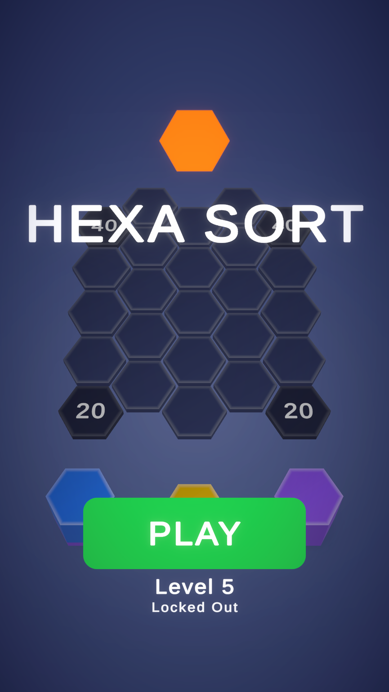
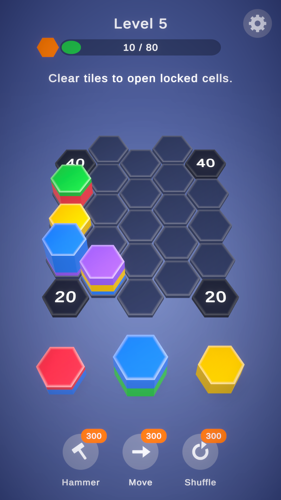
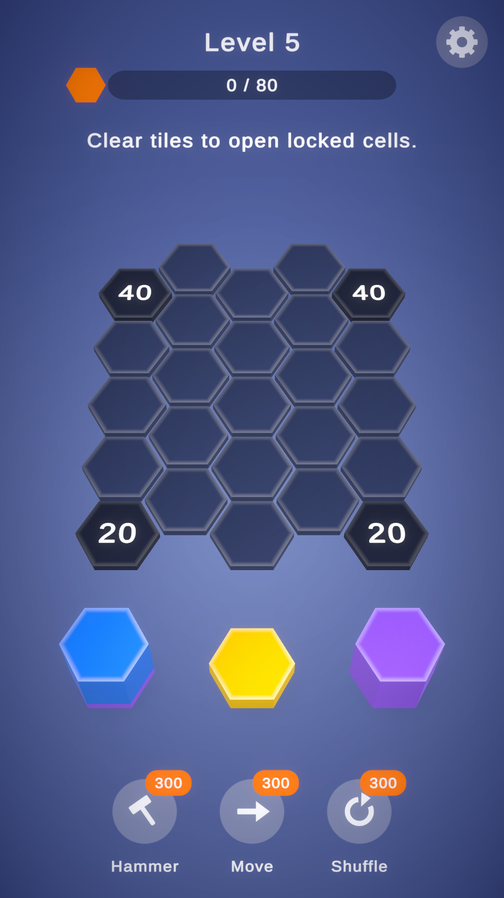

# Hexa Sort (Clone)

A portfolio-quality Unity clone of the hyper-casual puzzle game **Hexa Sort**.
Drag stacks of colored hex tiles from the tray onto a hex board. Matching top colors flow from stack to stack, each tile flipping over the edge it crosses. When 10 or more tiles of one color gather on top of a stack, that group pops. Clear the level's tile goal before the board fills up.

The focus of this project is **clean architecture, a deterministic and tested game core, data-driven tooling and game feel**. The game itself matters too.

| Home | Merge chain | Locked cells |
|:---:|:---:|:---:|
|  |  |  |

> More of my projects: **[burak-unye.vercel.app](https://burak-unye.vercel.app)**

---

## Highlights

- **Pure C# game model** (`noEngineReferences`): hex math, board, stacks, merge resolver, tray generator, session, levels, persistence and boosters. It runs and is tested outside Unity.
- **Deterministic `MergeResolver` that outputs a step list.** Logic and animation are fully separate: the view only replays `TransferStep` / `ClearStep`.
- **Property-tested rules.** Thousands of simulated moves check that every resolve:
  - ends stable,
  - conserves tiles,
  - moves tiles only between neighbours,
  - can be replayed from its steps to the exact final board.
- **Bot-calibrated difficulty.** A greedy simulation bot measured how hard each level is, and the 100 campaign levels were tuned on that data (see [Difficulty](#difficulty-and-the-simulation-bot)). Tests keep every level winnable.
- **Hex Board Editor** (`EditorWindow`): paint cells, locks and preplaced stacks with the mouse, tune the tray generator, validate, and **simulate win rate** in one click.
- **Game feel:**
  - Tiles flip one by one along an arc.
  - The receiving stack squashes as tiles land.
  - Clears pop tile by tile with particles, and icons fly into the goal counter.
  - Combo popups, camera shake, haptics and procedural audio.
  - While dragging: a drop preview silhouette, merge-candidate neighbours that rise, and a ground shadow.
- **Boosters:** Hammer, Move and Shuffle, with persistent counts.
- **Mobile-ready:** portrait 1080×1920, safe area, 60 FPS target, pooled tiles, stacks and FX, no allocations in `Update`, one scene, SRP Batcher with one material per color.
- **181 EditMode tests**, plus a one-click scene builder: no manual wiring.

## Tech

| | |
|---|---|
| Engine | Unity **6000.0.58f2** (Unity 6) |
| Rendering | URP, forward renderer, custom stylized shader (fake lighting, layer rims), procedural hex meshes |
| Input | Input System (`Pointer`: mouse and touch) |
| UI | uGUI + TextMeshPro, built from code |
| Tests | Unity Test Framework (NUnit), EditMode |
| Third-party | **none**: no DOTween, no art or audio packs |

All meshes, UI sprites (rounded panels, hexagons, booster icons) and placeholder sounds are **generated procedurally**, so the repository contains no binary art.

---

## Getting started

1. Clone the repo and open the folder with **Unity 6000.0.58f2** (or a newer Unity 6).
2. Run **`Tools → HexaSort → Setup Game Scene`**.
   - The first run imports *TMP Essential Resources*. Run the menu again when that finishes.
   - The tool adds a forward Universal Renderer (the template ships with the 2D one). It also creates the meshes, materials, prefabs, `VisualConfig`, the level assets, the audio library and a fully wired `Scenes/Game.unity`, and sets portrait orientation.
3. Set the Game view to **1080×1920** (or use the *Simulator*) and press **Play**.

| Menu | What it does |
|---|---|
| `Tools/HexaSort/Setup Game Scene` | (Re)generates the scene and assets. Assets are updated in place, so GUIDs stay stable. |
| `Tools/HexaSort/Level Editor` | Hex Board Editor (see below). |
| `Tools/HexaSort/Rebuild Campaign Levels` | Rewrites levels 1–100 from `Campaign.cs` / `CampaignLate.cs`. Asks for confirmation. |
| `Tools/HexaSort/Reset Progress` | Level 1, settings on, boosters back to 300. |
| `Tools/HexaSort/Capture Screenshot` (F12) | Saves the Game view to `docs/media/` (Play Mode). |

**Debug keys (editor and development builds):** `R` restart, `W` win, `F` fail screen.

**Run the tests:** `Window → General → Test Runner → EditMode → Run All`.

---

## Architecture

```
┌──────────────────────────────────── HexaSort.Game (MonoBehaviours) ─────────────────────────────────────┐
│                                                                                                         │
│  DragController ──drop──►  GameManager  ◄──commands──  UIManager / BoosterBar ──► panels, HudView       │
│  BoosterController ─────►  (state machine,  ──events──► GoalIconFlight, ComboPopup                      │
│                            composition root) ──events──► FeedbackController ─► AudioManager, Haptics,   │
│                                │       │                                       CameraFitter.Shake,      │
│                     place/move │       │ animate steps                         TileBurstFx, Confetti    │
│                                ▼       ▼                                                                │
│                         ┌─────────────┐  MergeSequencePlayer ─► BoardView ─► HexCellView, StackView     │
│                         │ GameSession │  TrayView, DropPreview, CameraFitter    (TilePool, StackViewPool)│
│                         └─────────────┘  LevelManager ─► LevelDatabase / LevelData (ScriptableObjects)  │
└────────────────────────────────│────────────────────────────────────────────────────────────────────────┘
                                 ▼
┌─────────────────────────── HexaSort.Model (pure C#, no UnityEngine) ────────────────────────────────────┐
│  HexCoord · HexLayout · HexStack · BoardCell · BoardModel · MergeResolver · MergeSteps · Rng            │
│  StackGenerator · Tray · LevelGoal · GameSession · BoosterInventory · ProgressService (IKeyValueStore) │
│  LevelDefinition · Campaign · ProceduralLevels · BoardShapes · Simulation/LevelSimulator               │
└─────────────────────────────────────────────────────────────────────────────────────────────────────────┘
        ▲                                                   ▲
  HexaSort.Editor (GameSceneBuilder, UIBuilder,       HexaSort.Tests.EditMode
  LevelEditorWindow, CampaignAssetBuilder, SpriteBaker)
```

| Assembly | Depends on | Responsibility |
|---|---|---|
| `HexaSort.Model` | – (`noEngineReferences: true`) | All rules. Deterministic, reusable by the game, the tools and the tests. |
| `HexaSort.Utils` | UnityEngine | Hex prism mesh builder, easing, procedural audio. |
| `HexaSort.Game` | Model, Utils, Input System, TMP, uGUI | `Core` (flow, input, levels, boosters, feedback), `View` (board, stacks, animation, camera, FX), `UI` (screens). |
| `HexaSort.Editor` | all of the above | Scene/UI builders, Hex Board Editor, campaign asset writer, sprite baker, screenshot tool. |
| `HexaSort.Tests.EditMode` | Model, Game | Unit, property and simulation tests. |

- **The model knows nothing about Unity.** `GameSession.Place(slot, cell)` returns a `PlaceOutcome`: the merge steps, unlocked cells, whether the tray refilled, and win/fail. Views only animate that outcome; they never decide anything.
- **`GameManager` is the composition root.** It runs the state machine `Loading → Home → Playing ⇄ Resolving → Win / Fail`.
- **Listeners, not polling.** `GameManager`, `MergeSequencePlayer`, `DragController` and `BoosterController` expose C# events.
  - `UIManager` is a presenter.
  - `FeedbackController` is the *only* place where events become sound, haptics, shake and particles. Tuning the feel never touches rules or views.
- **No singletons.** References are serialized and wired by the scene builder. The only static is a fire-and-forget `UIEvents.ButtonPressed`.
- **Levels are data.** `LevelData` assets are a thin serializable shell that converts to the engine-free `LevelDefinition`. Gameplay, tests and the simulation bot all use that same type.
- **View/model sync check.** In editor and development builds, `BoardView.ValidateAgainst(board)` runs after every move and reports any stack view that differs from the model.

### Life of a drop

```
Pointer drag            → DragController: stack floats above the finger; hovered cell = cell under the stack
                        → DropPreview ghost + BoardView.SetMergePreview (matching neighbours rise)
Release on valid cell   → GameManager.Drop(slot, cell)
                        → GameSession.Place → MergeResolver.Resolve → PlaceOutcome (all logic done, instantly)
                        → GoalChanged (authoritative count) → state Resolving
                        → stack lands (squash) → MergeSequencePlayer.Play(steps)
                              TransferStep: tiles fly one by one, flip 180°, target punches  → TileLanded
                              ClearStep:    tiles pop top-down, burst, icon flies to badge   → TilePopped
                        → unlock animations, tray refill → Win / Fail / Playing
```

---

## Merge algorithm

`MergeResolver.Resolve(board, placedCell)` mutates the board until it is stable and records every change as a step:

```csharp
abstract class MergeStep
sealed class TransferStep(from, to, color, count)   // top group of `from` moves onto `to`
sealed class ClearStep(cell, color, count, combo)   // top group reached the threshold and pops
```

**Rules:**

1. Work queue = `[placed cell]`.
2. Pop cell **X** with top color **C**. Collect the neighbours **M** whose top color is also C. If M is empty, go to the next cell.
3. Pick a target **T** from `{X} ∪ M` by lexicographic priority:
   1. a **uniform** stack (only C), because giving tiles to it buries nothing;
   2. the larger C top group;
   3. more C-topped neighbours;
   4. X itself;
   5. earlier neighbour in fixed direction order.
4. Every `m ∈ M \ {T}` pours its C group onto X. If `T ≠ X`, X then pours its now-combined group onto T. **Tiles only ever travel between adjacent cells.**
5. Enqueue T, the donors and X, because their top colors changed.
6. When the queue drains, clear every top group of size ≥ threshold (10, configurable), in board order. Cleared cells are enqueued and the loop repeats. The board is stable when nothing clears.

**Example** (from the tests). `RB` is placed at the centre. Its neighbours are `GB`, `YB` and a uniform `B`:

```
Transfer (1,0)->(0,0)  1×B     neighbours funnel into the placed stack …
Transfer (-1,0)->(0,0) 1×B
Transfer (0,0)->(0,1)  3×B     … which pours the combined group onto the uniform stack
result: (0,1)=BBBB, (0,0)=R, (1,0)=G, (-1,0)=Y
```

**Change from the suggested rule.** The suggested rule lets T collect directly from every match. When T is not X, some of those matches are not adjacent to T, so tiles would jump across X. Funnelling through X keeps every move between neighbours, catches every match around X, and gives satisfying chains for free.

**Why it terminates.**
- A donor always gives away its *whole* top group, so its top color changes.
- A receiver's group only grows, so it keeps winning rule 3 against the stacks it absorbed.
- Clears strictly remove tiles.
- A hard iteration cap (`HitIterationLimit`) still guards against future rule changes, and the property tests assert that it is never reached.

**Determinism.** Neighbours are visited in a fixed direction order and cells in board insertion order. The same board always yields the same steps (tested). The resolver reuses its queue and buffers, so it allocates nothing besides the result.

**Tests** (`MergeResolverTests`): no match, mixed vs uniform, larger group wins, ties, neighbour-count tie-break, triple funnel, chain from a revealed color, clear, clear threshold, clear then chain, double clear (combo), mixed colors, determinism, and the random-game property test (5 seeds × 20 games × up to 200 moves).

---

## Tray generation

`StackGenerator` is seeded with its own xorshift `Rng`, so levels replay identically on every platform (`System.Random` is not specified across runtimes).

- **The top color is chosen first**, because it is the only color that matters on placement. Lower groups are then picked so that neighbouring groups always differ.
- **Match bias:** the probability that the top color is drawn from the *mergeable tops*, meaning tops of stacks next to an empty cell.
- **Mercy rule:** if the board offers any merge, at least one stack of every tray refill can take it. A test checks this on 900 random boards, and a control test shows that without mercy, unmergeable trays really do happen.

## Difficulty and the simulation bot

`LevelSimulator` plays a level with a one-ply greedy bot. It simulates only placements that actually merge, which keeps it fast, and scores them by tiles cleared and moved. Running it on the first draft of the campaign was humbling: the bot won **every level 100 %** and, with no goal, kept going for 3 000 moves.

A parameter sweep explained why. Difficulty is almost entirely **colors relative to board size**, with a sharp threshold:

| Board | 5 colors | 6 colors | 7 colors | 8 colors |
|---|---|---|---|---|
| 12 cells | median 888 tiles before failing | 116 | 41 | 33 |
| 19 cells (hex r2) | endless | endless* | 922 | 245 |
| 25 cells | endless | endless | endless* | 809 |
| 37 cells (hex r3) | endless | endless | endless | endless |

<sub>“endless” = the bot never failed within the move cap; \* = rare early fails.</sub>

- Match bias and mercy barely move this.
- Ring-shaped boards (fewer adjacencies), holes and locks shift the threshold down.

The campaign was redesigned around this threshold, and every target was chosen from the bot's distribution of tiles cleared before failing, aiming at a sawtooth curve:

| Levels | Bot win rate (100 games) | Notes |
|---|---|---|
| 1–3 | 100 % | Tutorials: 12–19 cells, 2–3 colors, on-screen hints |
| 4–9 | 97–100 % | 5 introduces locks, 6 preplaced stacks |
| 10, 12, 14, 15, 17 | 70–78 % | Spikes |
| 11, 13, 16 | 99–100 % | Breathers after spikes |
| 18 / 19 / 20 | 84 / 59 / 68 % | Finale |

**Levels 21–100** are built from 18 board templates (shape, palette size, locks scaled to the target) by a calibration tool:
- Each level gets a desired bot win rate, sliding from 88 % (level 21) to 45 % (level 100), with breathers on every x5 and bosses on every x0.
- Each template's capacity distribution (tiles cleared before failing) was measured once with 100 bot games.
- Per level, the tool picks the template whose required target best matches the level's intended length. It penalises templates used often and prefers 7 colors early and 8 colors late, then reads the target off the distribution.
- Measured result (60 games each): 21–30: 70–97 %, 51–70: 52–78 %, 91–100: 37–65 %. Breathers stay at 82–100 %.

- **Past level 100,** `ProceduralLevels` remixes levels 51–100 with new seeds and targets that grow 8 % per lap.
- **Regression guard:** `CampaignTests` asserts a win-rate floor for all 100 levels, and that the average win rate falls from levels 21–40 to 51–70 to 81–100. A rule or generator change that breaks the curve fails CI.

## Level system and Hex Board Editor

- **`LevelData`** (ScriptableObject) holds:
  - axial cells, plus lock flags and the unlock score for locked cells;
  - preplaced stacks;
  - target tiles and the clear threshold;
  - the tray generator settings: colors, tile and group ranges, bias, mercy, seed;
  - an optional tutorial hint.

  `LevelDatabase` keeps the order.
- **`Campaign.cs`** is the design source of the handcrafted levels 1–20, and **`CampaignLate.cs`** holds the templates and calibrated table for 21–100. A fluent builder keeps the table readable:

  ```csharp
  New(5, "Locked Out", colors: 5, target: 80, ...).Tutorial("Clear tiles to open locked cells.")
      .Cells(BoardShapes.Rectangle(5, 5)).Lock(Rect(0, 0, 5, 5), 20) ...
  ```

- **Validation** rejects:
  - no free cell at start;
  - preplaced stacks on locked or missing cells;
  - colors outside the palette;
  - starting boards that are not already stable (matching tops, groups ≥ threshold).

**Hex Board Editor** (`Tools → HexaSort → Level Editor`):

- **Left:** the level list (add, duplicate, delete, reorder, rebuild campaign).
- **Centre:** the board canvas, with three paint tools:
  - **Cells:** click or drag to add, right-click to remove.
  - **Locks:** set an unlock score.
  - **Stacks:** build a brush stack from the palette and click to place it.
- **Right:** name, hint, goal and generator settings; shape presets; **Validate**; **Simulate** (bot win rate, average moves, average progress).
- Every edit supports Undo and is saved straight into the asset.

**Locked cells** show their unlock score on the cell. When the score is reached, the cell pops open and the label floats away.

## Game feel

| Event | Feedback |
|---|---|
| Drag | The stack lifts above the finger and grows 10 %. A translucent silhouette in the top color appears on the hovered cell, neighbours that would merge rise, and a shadow follows on the ground. An invalid drop eases back to the tray. |
| Drop | The stack lands with a squash, thud and medium haptic. |
| Transfer | Tiles leave one by one (staggered), arc and flip 180° over the shared edge. The receiving stack punches. The pitch rises per tile, with light haptics (throttled). |
| Clear | Tiles pop top-down (grow, then shoot up and shrink) with colored hex particles, a soft flash that grows with the chain and rising sparks. One icon per tile curves into the goal badge, and the counter ticks on arrival. |
| Combo | "COMBO x2/x3…" popup, rising chime, camera shake that scales with the combo, heavy haptic. A single clear of 15+ tiles shows "GREAT!". |
| Unlock / Win / Fail | Cell pop and chime / confetti cannons, light rays spinning behind the badge and fanfare / shake and sad jingle, each with a native haptic. |

**Look and lighting** (all without real-time lights or shadow maps):
- `HexaSort/Stylized` shader: half-Lambert fake light, a glossy bevel ring around every top cap (the cap UVs run from the centre to the rim), a light gradient across the cap and a soft edge light on the sides.
- `BlobShadow`: a soft contact shadow under every stack that stays on the ground when the stack is lifted, shrinking and fading with height.
- A pool of light on the floor under the board, plus URP post-processing (bloom on the highlights, vignette, a little contrast and saturation) from a generated `PostFX` volume profile.

**Haptics:**
- iOS: `UIImpactFeedbackGenerator` / `UINotificationFeedbackGenerator` via `Plugins/iOS/HexaSortHaptics.mm`.
- Android: `VibrationEffect.createOneShot` with an amplitude per event.
- Sound and vibration can be switched off in Settings.

**Audio:** `AudioLibrary` maps sound ids to clips. Ids without clips use generated placeholders.

## Boosters

| Booster | Flow | Model |
|---|---|---|
| Hammer | Tap the button, then a stack. It is squashed and shattered (not scored). | `GameSession.Hammer(cell)` |
| Move | Tap a stack (it lifts and valid cells light up), then an empty cell. The stack hops there and merges resolve as for a placement, so a move can win. | `GameSession.Move(from, to)` |
| Shuffle | Instantly replaces all three tray stacks (mercy still applies). | `GameSession.ShuffleTray()` |

Each booster starts at 300 and its count persists through `BoosterInventory` (`IKeyValueStore`). When the starting count is raised in an update, existing saves are topped up once. Tapping the active booster again cancels it, and tray dragging is paused while a target is being chosen.

## Performance

- **Pooling:** tiles (`TilePool`), stacks (`StackViewPool`), cells, flying icons, combo texts. All particle bursts share one particle system and are emitted with a per-call color.
- **No allocations in `Update`:**
  - Animations run in single loops over reused lists.
  - Icons and popups use struct state.
  - The resolver reuses its buffers.
- **Components sleep when idle:** `StackView` punch, `HudView`, `UIPanel`, `ButtonPressScale`, `ComboPopup`.
- **Draw calls:**
  - One shared material per tile color plus SRP Batcher.
  - A custom shader with fake lighting, so there are no realtime lights or shadow maps.
  - HDR is off and MSAA is 4× (cheap on tile-based GPUs).
- `Application.targetFrameRate = 60`, single scene.

## Project structure

```
Assets/_Project/
├── Scripts/
│   ├── Model/              # pure C#: hex math, board, resolver, generator, session, levels, boosters
│   │   └── Simulation/     # LevelSimulator (greedy bot)
│   ├── Core/               # GameManager, DragController, BoosterController, LevelManager, PlayerPrefsStore
│   │   ├── Levels/         # LevelData, LevelDatabase (ScriptableObjects)
│   │   ├── Audio/          # AudioManager, AudioLibrary
│   │   └── Feedback/       # FeedbackController, Haptics
│   ├── View/               # BoardView, StackView, TrayView, MergeSequencePlayer, CameraFitter, FX
│   ├── UI/                 # UIManager, HudView, BoosterBar, GoalIconFlight, ComboPopup, panels
│   ├── Utils/              # HexMeshBuilder, Easing, ProceduralAudio
│   └── Editor/             # GameSceneBuilder, UIBuilder, LevelEditorWindow, CampaignAssetBuilder, SpriteBaker
├── Tests/EditMode/         # NUnit: resolver, model, progression, campaign (bot), boosters, assets
├── Levels/                 # Level_01 … Level_100 + LevelDatabase
├── Art/                    # Shaders (Stylized, Ghost, Particle), Meshes, UI sprites
├── Materials/ · Prefabs/ · Scenes/ · Settings/
└── Plugins/iOS/            # native haptics
```

## Possible next steps

- **Smarter bot:** two-ply lookahead or Monte Carlo rollouts, to estimate human difficulty more closely. Use it to auto-tune targets in the editor.
- Real SFX and music, and a richer art pass (bevelled tiles, board frame, background gradient).
- PlayMode tests for the flow, and CI with [GameCI](https://game.ci) (tests + Android build).
- Analytics hooks (level start/fail/complete, booster use) and ad/IAP integration points for revive and boosters.

## Recording media

**Automatic screenshots:** set the environment variable `HEXASORT_SHOTS` to a folder and run the PlayMode tests (`GameSmokeTests` plays a few drops on the generated scene and renders 1080×1920 PNGs; without the variable it only checks that nothing throws).


- **GIF:** Unity Recorder (*Window → General → Recorder*) at 540×960 and 30 fps, then `ffmpeg` or [ezgif](https://ezgif.com).
- **Screenshots:** press **F12** in Play Mode (`Tools/HexaSort/Capture Screenshot`). They are saved to `docs/media/`.
- Expected names: `gameplay.gif`, `home.png`, `chain.png`, `locks.png`, `editor.png`.

---

*Fan-made clone for learning and portfolio purposes. Not affiliated with Lion Studios or the original developers. All code is original; all art and sound in this repository is procedurally generated.*
